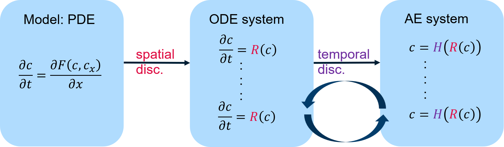

---
jupytext:
  formats: md:myst
  text_representation:
    extension: .md
    format_name: myst
    format_version: 0.13
    jupytext_version: 1.19.5
kernelspec:
  display_name: Python 3 (ipykernel)
  language: python
  name: python3
---

# 99.7a Cracking the Core: Numerics behind CADET

## Contents

**Tools:** Locally running CADET-Equations, CADET-Core documentation.

**Python used:** Displaying a local web application with `IFrame`.

**Introduces:** Mathematical modeling of chromatography, partial differential-algebraic equations, the method of lines, and numerical parameters controlling accuracy and runtime.

1. Selecting the model: transport, particles, binding and reactions
2. Solving the model: spatial discretization and time integration
3. Choosing numerical parameters in CADET
4. Scope and outline of the numerics session

A model specifies the physics; numerical settings determine how its equations are solved. This session connects those settings to practical questions about accuracy, runtime and failed simulations.

+++

## Selecting the model

- Chromatographic processes can be described by systems of **Partial differential (algebraic) equations (PD(A)E)**.
- Different models represent various physical phenomena at different levels of complexity:
    - **Transport:** Convection, dispersion, film and pore diffusion
    - **Dimensionality:** 1D, 2D, 3D -> different (apparent) dispersion, bed resolution
    - **Particle Model**: resolution of film-, pore-diffusion, porosity, particle-size distribution, ...
    - **Binding:** Variety of sorption mechanisms: ion-exchange, colloidal, hydrophobicity, ...
    - **Reactions:** Mass-action law, Michaelis Menten
    - **Flow Geometry:** Axial, radial -> variable velocity profile, dispersion and film diffusion dependence
\
- **CADET-Core covers a vast model family:**
    - Governing equations and assumptions: **[CADET-Equations](https://equations.cadet-web.de/)**
    - Further details: **[CADET-Core Documentation](https://cadet.github.io/v5.1.X/index.html)**

```{code-cell} ipython3
# Executing this code requires running cadet-equations locally
from IPython.display import IFrame, display
display(IFrame(
    src="http://localhost:8501",
    width="100%",
    height=700
))
```

## Solving the model

- Analytical solutions are generally unavailable for realistic chromatography models
- **Method of lines** is used to solve the PD(A)E that model chromatography:
    - Separate, **sequential discretization of spatial and time coordinate**
    - Spatial discretization yields an OD(A)E 
    - Tempooral discretization yields an Algebraic system that requires a nonlinear solving procedure 



+++

## Using CADET - Choosing Numerical Parameters

- **CADET users need to select suitable parameters** to obtain accurate and efficient simulations.
- Depending on the model and numerical method, numerous parameters must be configured:
    - Spatial Discretization: `SPATIAL_METHOD`, `NCOL`, `NPAR`, `WENO_ORDER`, `RECONSTRUCTION`, `INTEGRATION_TYPE`, ...
    - Temporal Discretization: `ABSTOL`, `RELTOL`, `ALGTOL`, ...
    - Solver configuration: `CONSISTENT_INIT_MODE`, ...
    - Linear Alebra: `GS_TYPE`, `MAX_KRYLOV`, `MAX_RESTARTS`, `SCHUR_SAFETY`, ...


Some have defaults that usually work, but **some are very problem-specific**.
This raises several practival questions:
- What are **good defaults**?
- Simulation **crashes**: What to do?
- Simulation is **slow**: What to do?
- Simulation is "**inaccurate**": What to do?
- How to **balance** accuracy and runtime?
- Can the same numerical settings be **reused** for other simulations?

+++

## Scope of this session

This session aims to **educate the general CADET user**, non-mathematicians, on the **numerical mechanisms and input** parameters **with flexible amount of technical depth**.

### Outline
| # | Session | Description |
|---|-------|-----------|
| 99.7b | **[Spatial discretization](99.7b_spatial_discretization_lesson.md)** | Insights on spatial semi-discretization and the corresponding numerical parameters |
| 99.7c | **[Time integration](99.7c_time_discretization_lesson.md)** | Insights on time integration in CADET using IDAS and the corresponding numerical parameters |
| 99.7d | **[Stiffness](99.7d_stiffness_lesson.md)** | Concept of stiffness and its relevance for simulation |
| 99.7e | **[Nonlinear solver](99.7e_nonlinear_solver_lesson.md)** | Solving the fully discretized nonlinear system |
| 99.7f | **[Consistent initialization](99.7f_consistent_initialization_lesson.md)** | Why do we need it, time section transitions, restart of the time integrator |
| 99.7g | **[User stories](99.7g_user_stories_lesson.md)** | Selected user contributions from the forum and how their issues were fixed |

+++

## Summary

- The selected model determines which physical processes and spatial domains need to be considered.
- The **method of lines** first discretizes the spatial domains and then integrates the resulting system over time. Implicit time integration requires solving algebraic systems at each time step.
- Numerical settings influence the **accuracy, runtime, and robustness** of a simulation. Choosing appropriate settings is essential for obtaining reliable results efficiently.

**Next lesson:** **[99.7b Spatial Discretization](99.7b_spatial_discretization_lesson.md)** explores FV and DG methods, the effect of spatial refinement on accuracy, and the trade-off between accuracy and computational cost.
