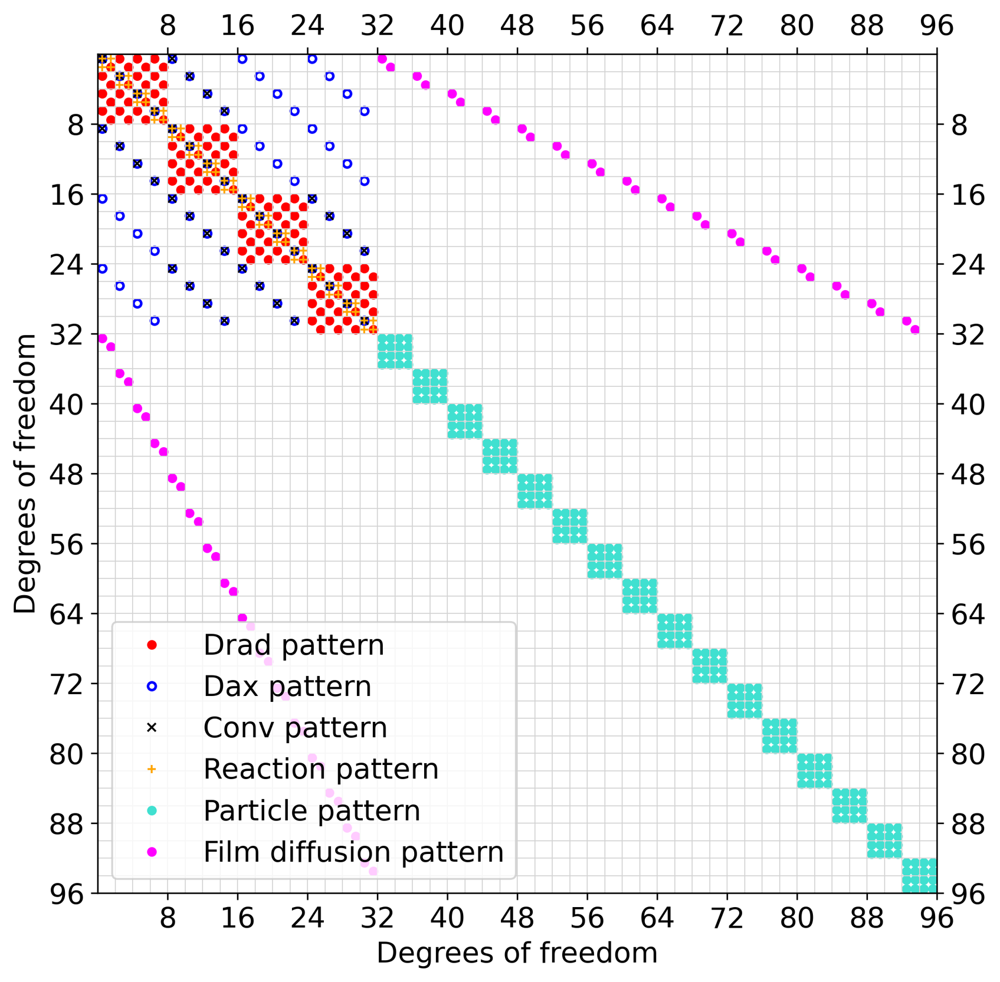
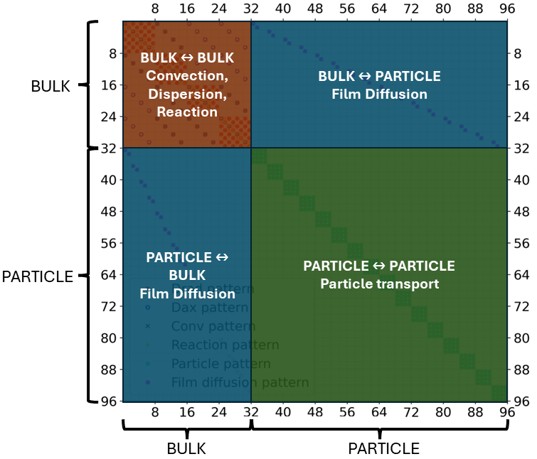

---
jupytext:
  formats: md:myst
  text_representation:
    extension: .md
    format_name: myst
    format_version: 0.13
    jupytext_version: 1.19.5
kernelspec:
  display_name: Python 3 (ipykernel)
  language: python
  name: python3
---

# 99.7c Time Discretization

## Contents

**Tools:** IDAS through CADET-Python; convergence calculation helpers and the time-tolerance explorer widget.

**Python used:** Imports, function definitions, keyword arguments, conditionals, arrays, lists and plotting.

**Introduces:** Backward differentiation formulas (BDF), adaptive time stepping, `ABSTOL`, `RELTOL`, tolerance refinement, residual equations, Newton iterations and the Jacobian matrix.

1. IDAS time integration
2. Absolute and relative error tolerances
3. Tolerance refinement in a load-wash-elute example
4. Accuracy and runtime for kinetic Langmuir adsorption
5. The Jacobian and its physical block structure
6. Why chromatography models use implicit integration

After discretizing space, CADET advances the model in time. We vary integration tolerances to observe their effect on the numerical error and computational cost.

+++

## Time discretization
After spatial discretization using the FV or DG method, **spatially semi-discretized ordinary differential equations** remain to be solved.
CADET uses IDAS from the [<u>SUNDIALS software package</u>](https://sundials.readthedocs.io) to integrate the corresponding initial value problem in time:
$$
F(t, y, \dot{y}) = 0, \quad y(t_0)=y_0, \quad \dot{y}(t_0)=\dot{y}_0.
$$
Furthermore, IDAS can handle **ODAE** of index one, arising from **algebraic contraints** in rapid-equilibrium binding or reaction models.
IDAS also computes sensitivity gradients of model parameters $p_i$, for which the **forward sensitivity** system is solved
$$
\frac{\partial F}{\partial y} s_i + \frac{\partial F}{\partial \dot{y}} \dot{s}_i + \frac{\partial F}{\partial p_i} = 0,
\quad s_i(t_0) = \frac{\partial y_0(p)}{\partial p_i},
\quad \dot{s}_i(t_0) = \frac{\partial \dot{y}_0(p)}{\partial p_i}.
$$

IDAS uses a numerical technique called a **Backward Differentiation Formula (BDF)** to advance the solution in time.
This method is an implicit time integration scheme and thus well-suited for **stiff systems**, as further explained in [the stiffness lecture](99.7d_stiffness_lesson.md).
Generally speaking, stiff problems arise when different parts of the system evolve at very different speeds, which is usually the case in chromatography models.

Because BDF is an implicit method, each time step requires **solving a nonlinear system** of algebraic equations arising from the spatially discretized model. That is, IDAS must determine the solution at the new time step by solving

$$
G(y_n) := F \left( t_n, y_n, h^{1}_n \sum_{i=0}^q \alpha_n y_{n-i} \right) = 0,
$$

where $F$ is the **residual** function defined by the spatially discretized model equations, $t_n, y_n, h_n$ are the current time point, solution, and time step, $\alpha_{n,i}$ is a factor depending on the time step size $h$, BDF order $i\leq q$.

**IDAS adapts the time-step size to guarantee specified error tolerances using a predictor-corrector approach.**

The non-linear system is solved using a [<u>Newton method</u>](https://en.wikipedia.org/wiki/Newton%27s_method).

### CADET user and developer interaction with IDAS:

- **Specifying error tolerances:** How accurate does our solution need to be? The choice of error tolerances involves a trade-off between computational cost and accuracy.

- **Providing consistent initial values:** $y_0$ and $\dot{y}_0$ must satisfy the OD(A)E $F(t, y, \dot{y}) = 0$. CADET has consistent initialization algorithms to solve this automatically but that can fail some times. Such fails are part of the [user stories notebook](99.7g_user_stories_lesson.md)

- **Providing a Jacobian (devs only):** The Newton method requires solving

$$
\frac{\partial G}{\partial y} \left[y_{n,m+1} - y_{n,m} \right] = -G(y_{n,m}),
$$
where $y_{n,m}$ is the current solution of the $m$th Newton iteration.
The Jacobian can also be computed from the residual via **automatic differentiation**, which is more costly than calling an analytical implementation.

+++

## *Choosing Error Tolerances*

CADET and IDAS take a relative (`RELTOL`) and absolute (`ABSTOL`) error tolerance as user-input.
The choice influences both **accuracy and computational cost**.
Both tolerances work together to control the estimated error during time integration, following:

$$
|e_i| = \mathrm{ABSTOL} + \mathrm{RELTOL}\cdot |y_i|,
$$

where $e_i$ is the estimated local error and $y_i$ is the corresponding solution component. 

- **Relative tolerance (`RELTOL`)** controls the error **relative to the solution** and is particularly relevant for larger solution values.
- **Absolute tolerance (`ABSTOL`)** sets the absolute error scale, particularly **important close to zero**.

For example, a relative tolerance of $10^{-4}$ and an absolute tolerance of $10^{-8}$ allow an estimated local error on the order of $10^{-4}$ for solution values around $1$, and $10^{-8}$ for values close to zero.

**Choosing suitable tolerances** is becomes important when computational time is relevant.
Tighter tolerances generally require more computational effort, but do not necessarily improve the overall solution accuracy if **other numerical errors**, such as spatial discretization errors, dominate.

+++

## <span style="color: red;"> **Important Note:**</span>
Throughout this notebook, the spatial discretization error was fixed so that the time discretization error always dominates. That way, we can investigate time discretization separately.

Combining the insights of this notebook and the [spatial discretization notebook](99.7b_spatial_discretization_lesson.md), **spatial and temporal** discretization parameters should be **selected to achieve similar accuracy**.
Otherwise, the **larger error dominates** and the computational requirements of the other discretizations attempted lower error renders the **simulation inefficient**.


+++

### Refinement study
A practical approach is to start with low tolerances, e.g., `ABSTOL = 1e-10` and `RELTOL = 1e-8`, and perform a **refinement study**. Gradually relax or tighten the tolerances and compare the resulting solutions and runtimes.The goal is to find tolerances that provide sufficient accuracy without unnecessary computational cost.

To better understand the influence of these tolerances and how to select suitable values in practice, let us consider the following questions, which we will investigate through **two numerical examples**.

**Observe:**

1. How do different error tolerances affect the numerical solution and computational runtime?
2. How do `ABSTOL` and `RELTOL` interact? Are they independent of each other? 
3. How should we choose suitable error tolerances to balance accuracy and computational cost?

#### Example: Load-Wash-Elute
In the setting below, we consider a **load-wash-elute example** with three components and a salt, modeled by a [<u>General Rate Model</u>](https://cadet.github.io/v5.1.X/modelling/unit_operations/general_rate_model.html) with [<u>Steric Mass-Action Binding</u>](https://cadet.github.io/v5.1.X/modelling/binding/steric_mass_action.html#steric-mass-action-model). Change the error toloerances and investigate errors and computational efficiency.

```{code-cell} ipython3
import numpy as np
import matplotlib.pyplot as plt
from ipywidgets import interact, interactive
import ipywidgets as widgets
import os
from pathlib import Path
import sys

from cadet import Cadet
import utility.convergence as convergence
import utility.cadet_runtime as cadet_runtime
import utility.setting_Col1D_SMA_4comp_LWE_benchmark1 as lwe

# Configure the environment for the Cadet runtime and set up the DLL path
dll_directory = Path(sys.prefix) / "Library" / "bin"
os.environ["PATH"] = str(dll_directory) + os.pathsep + os.environ["PATH"]
cadet_runtime.configure()
path = os.getcwd()

def graph_column(idas_abstol=1e-1, idas_reltol=1e-1):

    model = Cadet()
    model.root = lwe.get_model(
        spatial_method_bulk=0,
        spatial_method_particle=0,
        particle_type='GENERAL_RATE_PARTICLE',
        axRefinement=2,
        parZ=4,
        return_bulk=True,
        idas_abstol=idas_abstol,
        idas_reltol=idas_reltol
    )
    
    model.filename = ('generated/02_time_discretization'
                      '/tolerance_widget.h5')
    model.save()
    data = model.run_simulation()

    if data.return_code != 0:
        print(data.error_message)
        print(data.log)
        return
    
    outlet = convergence.get_outlet(path+'/'+model.filename, unit="000")
    sol_time = convergence.get_solution_times(path+'/'+model.filename)
    
    reference = convergence.get_outlet(path+'/data/02_time_discretization/reference/ref_LWE.h5', unit="000")
    errorComp = np.max(abs(reference[:, 1:] - outlet[:, 1:])) / np.max(abs(reference[:, 1:]))
    errorSalt = np.max(abs(reference[:, 0] - outlet[:, 0])) / np.max(abs(reference[:, 0]))
    
    fig, axs = plt.subplots(1, 2, figsize=(12, 5))
    
    # First plot
    axs[0].plot(sol_time, outlet[:, 0])
    axs[0].set_xlabel(r'Time $[s]$')
    axs[0].set_ylabel(r'Concentration $[mol \cdot M^{-3}]$')
    axs[0].set_title("Salt")
    
    axs[1].plot(sol_time, outlet[:, 1:])
    axs[1].set_xlabel(r'Time $[s]$')
    axs[1].set_title("components")

    fig.suptitle(
        f"Sim. time: {convergence.get_compute_time(path + '/' + model.filename):.3g} s \n" + f"Rel. max. error salt: {errorSalt*100:.2f}% \n" + f"Rel. max. error comps: {errorComp*100:.2f}%",
        fontsize=14
    )
    
    plt.tight_layout()
    plt.show()

abstol_steps = [10**i for i in range(-12, 3)]
abstol_options = [(f"{v:.0e}", v) for v in abstol_steps]

reltol_steps = [10**i for i in range(-12, 3)]
reltol_options = [(f"{v:.0e}", v) for v in reltol_steps]

interact(
    graph_column,
    idas_abstol=widgets.SelectionSlider(
        options=abstol_options,
        description="abstol"
    ),
    idas_reltol=widgets.SelectionSlider(
        options=reltol_options,
        description="reltol"
    )
)
```

### Example: LRM with Kinetic Langmuir Adsorption

Consider a **single-component Lumped Rate Model (LRM)** with **kinetic Langmuir adsorption** with $k_a = 1\,\mathrm{m^3\,mol^{-1}\,s^{-1}}$, $k_d = 1\,\mathrm{s^{-1}}$ and $q_{max} = 2\,\mathrm{mol\,m^{-3}}$. A short pulse of $c_{feed} = 5\,\mathrm{mol\,m^{-3}}$ is injected for $10\,\mathrm{s}$, which yields the typical asymmetric (tailing) peak of a nonlinear isotherm.

The **spatial discretization is fixed** (DG, $p=3$, 32 elements). The reference solution is computed on the same grid with very tight tolerances ($\mathrm{RELTOL} = 10^{-14}$, $\mathrm{ABSTOL} = 10^{-14}$), so the error
$$
e = \max_i \left| c(t_i) - c_{\mathrm{ref}}(t_i) \right|
$$
only measures the **time integration error**.

Change `RELTOL` and `ABSTOL` and observe the outlet solution, the $L^\infty$ error and the simulation time. The right plot collects all runs in a work-precision diagram.
- Which tolerance limits the error when `ABSTOL` is large? Which when it is small?
- Does decreasing `RELTOL` further always reduce the error?
- Which combination reaches an error of about $10^{-4}$ in the shortest time?

```{code-cell} ipython3
from IPython.display import display
from utility.time_tolerance_explorer import make_explorer

# Fixed spatial discretization (DG, p=3, 32 elements); only the IDAS tolerances are varied
tolerance_explorer = make_explorer(
    output_directory=Path('generated') / '02_time_discretization'
    / 'tolerance_study',
    polynomial_degree=3, n_elements=32,
)
display(tolerance_explorer)
```

## The Jacobian Matrix

The Jacobian describes how the residual equations change with respect to the solution variables. During implicit time integration, Newton's method uses the Jacobian (or a suitable approximation) to solve the nonlinear system at each time step. 
**This is where most of the compute time is spent!**

In CADET, the Jacobian has a **sparse block structure**, reflecting the coupling between different parts of the chromatography model, as illustrated in the figure below.

<div style="display: flex; justify-content: center; align-items: center; gap: 10px;">
  
  
</div>

Here, different colors define a **nonzero entry**. Each nonzero entry in the Jacobian indicates that a residual equation depends on a particular solution variable. The **different patterns** arise from the physical processes and their numerical discretization.
The Jacobian can be divided into **four main blocks**, depending on which equations and variables are coupled.

<details>
<summary><b>Click to learn more about the Jacobian pattern</b></summary>

- **Axial dispersion ($D_{\mathrm{ax}}$) pattern:** Couples neighboring axial positions through dispersion along the column.
- **Radial dispersion ($D_{\mathrm{rad}}$) pattern:** Couples neighboring radial positions through radial dispersion.
- **Convection pattern:** Couples axial positions through convective transport, with the coupling direction and extent depending on the numerical scheme.
- **Film diffusion pattern:** Couples the bulk (interstitial) and particle phases through mass transfer across the external particle surface.
- **Particle pattern:** Represents coupling between particle-related variables such as intraparticle transport.
- **Reaction pattern:** Represents local coupling between variables involved in reaction processes.

The location and extent of these patterns depend on the ordering of the solution variables, the chosen chromatography model (e.g., LRM, LRMP, GRM), and the spatial discretization method (FV or DG). We can learn a lot about the underlying model by examining the structure of its Jacobian.

As seen in the figure, axial dispersion, radial dispersion, convection, and reaction contributions are concentrated in the upper-left $32 \times 32$ block of the matrix. These patterns represent processes acting on the bulk (interstitial) phase in this example. Their location is not a coincidence: the first 32 degrees of freedom (DOFs) correspond to the bulk-liquid variables. Therefore, the upper-left block describes the **bulk–bulk coupling**, i.e., how the equations governing the bulk phase depend on the bulk-liquid variables. Reactions may also occur in the particle phase, depending on the model.

Looking more closely at this block, we can observe different patterns:

- **Radial dispersion:** Forms repeated diagonal subblocks because it couples radial positions within the same axial location.
- **Axial dispersion and convection:** Couple neighboring axial positions. The numerical scheme determines the coupling pattern and direction (e.g., upstream for convection, both directions for dispersion). The distance from the diagonal depends on the number and ordering of DOFs per axial position.
- **Reaction:** Unlike transport, reactions occur locally, coupling concentrations of reacting components at the same spatial position rather than neighboring cells. Therefore, their contributions appear within local diagonal subblocks.

The remaining blocks describe interactions involving the particle phase:

- **Particle–particle coupling (lower-right):** The turquoise blocks represent interactions between particle-related variables, such as intraparticle transport.
- **Bulk-particle and particle-bulk coupling:** Film diffusion transfers mass between the bulk liquid and particles. Since the equations of both phases depend on each other's concentrations, coupling appears in both off-diagonal blocks. 
</details>

\
**<span style="color: red;"> Important Note: </span>** An important observation is that **the distance of an entry from the main diagonal reflects the ordering of the variables in the solution vector, not necessarily their physical distance**. Therefore, the exact appearance of the Jacobian depends on how the degrees of freedom are arranged. The Jacobian is sparse because most physical processes couple only a limited number of variables. The block structure additionally reveals how these couplings are organized between different parts of the model.

During Newton iterations, the Jacobian is used to construct a linear system that must be solved. In CADET, `GMRES` is used for the finite volume (FV) method, while the discontinuous Galerkin (DG) method supports linear solvers such as `SparseLU`, `SparseQR`, and `BiCGSTAB`. The choice of linear solver affects the computational cost and efficiency of the simulation.

+++

## Why implicit time integration?

CADET is fixed to the IDAS BDF implicit time integration, which requires the computationally demanding work of solving nonlinear systems as described above.
But **why do we need that?**
The short answer is stiffness.
**Stiffness** is a challenging concept with several contributing factors.
Stiffness often arises when a system contains processes operating on very different time scales, which is often the case in chromatography.
**More details on this can be found in the [stiffness lecture notebook](99.7d_stiffness_lesson.md).**

+++

## Summary

- IDAS uses implicit BDF methods with adaptive time stepping, requiring nonlinear solves at each time step.
- `ABSTOL` and `RELTOL` work together to control time integration errors. Choosing appropriate tolerances requires considering both **accuracy and runtime**.
- Tighter time tolerances do not necessarily improve the overall accuracy if spatial errors dominate. Both sources of error should be considered.
- The Jacobian describes how the equations are coupled and is used to construct the linear systems solved within Newton iterations.

**Next lesson:** [**99.7d Stiffness**](99.7d_stiffness_lesson.md) explores what makes a system stiff, how stiffness affects numerical stability and computational cost, and why implicit time integration is often preferred.
